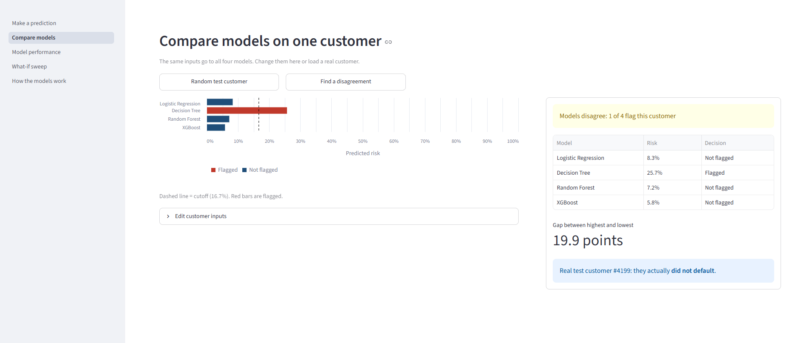
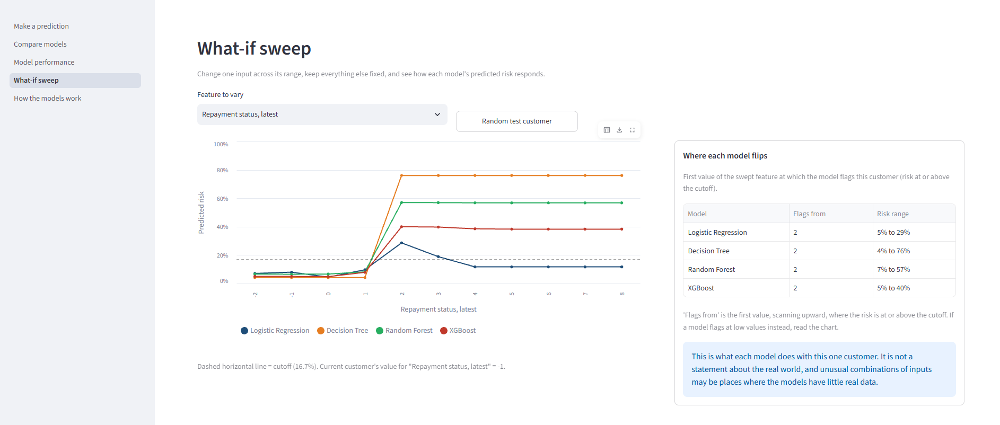
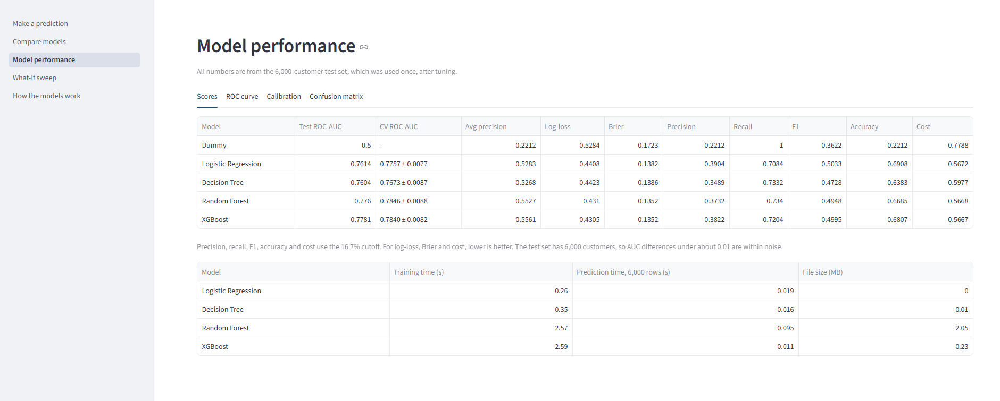
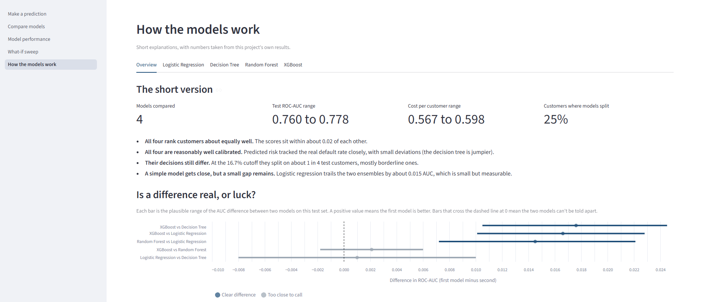

# Credit Default Prediction: Comparing Four ML Model Families

An interactive Streamlit app that runs the same credit-card customer through four machine-learning models and shows where they agree, where they disagree, and how they were evaluated.

**Live demo:** [credit-default-models.streamlit.app](https://credit-default-models.streamlit.app/) (free hosting, so it may need a moment to wake up)









## Overview

**Question:** will a credit-card customer miss next month's payment?

**Data:** [UCI Default of Credit Card Clients](https://archive.ics.uci.edu/dataset/350/default+of+credit+card+clients): 30,000 customers, Taiwan, 2005, about 22% default. Licensed CC BY 4.0, see License and data credit below. Stratified 80/20 split (24,000 train, 6,000 test). The test set was locked away before exploration and used for a single final evaluation. Later analyses reuse those saved predictions, and nothing was tuned on it.

**Models:** Logistic Regression, Decision Tree, Random Forest, XGBoost, plus a dummy baseline as the "no skill" reference.

The goal is not to crown a winner. It is to show how different model families behave on the same problem, and whether the differences are real.

## Approach

- Preprocessing lives inside scikit-learn pipelines, so nothing leaks across cross-validation folds.
- Identical tuning for every model: 20 random settings, 5-fold stratified cross-validation, ROC-AUC as the target. The winner is re-scored on fresh repeated folds.
- Decision cutoff chosen by cost, not by 0.5. Assuming a missed defaulter costs 5 times a false alarm gives a cutoff of 16.7%.
- Calibration checked on out-of-fold and test predictions.
- Paired bootstrap (1,000 resamples) on the test set to separate real gaps from noise.
- `SEX`, `AGE` and `MARRIAGE` are excluded from the models and kept in the CSVs for later auditing.

## Results

Test set (6,000 customers), cutoff 16.7%:

| Model | ROC-AUC | Avg. precision | Log-loss | Recall | Precision | Cost per customer |
|---|---|---|---|---|---|---|
| Dummy | 0.500 | 0.221 | 0.528 | 1.000 | 0.221 | 0.779 |
| Logistic Regression | 0.761 | 0.528 | 0.441 | 0.708 | 0.390 | 0.567 |
| Decision Tree | 0.760 | 0.527 | 0.442 | 0.733 | 0.349 | 0.598 |
| Random Forest | 0.776 | 0.553 | 0.431 | 0.734 | 0.373 | 0.567 |
| XGBoost | 0.778 | 0.556 | 0.431 | 0.720 | 0.382 | 0.567 |

Lower is better for log-loss and cost. The dummy flags everybody, so its recall is not skill. For Logistic Regression, Random Forest and XGBoost, cost per customer is about 27% below flagging everybody and 49% below flagging nobody. Full metrics are in `artifacts/`.

## Findings

1. **Ranking quality is similar.** All four are within about 0.02 ROC-AUC. XGBoost and Random Forest are statistically tied. XGBoost is ahead of Logistic Regression and the Decision Tree, and Random Forest is ahead of Logistic Regression, each by about 0.015 to 0.018 AUC (paired-bootstrap 95% intervals exclude zero). Logistic Regression and the Decision Tree are tied. Random Forest vs Decision Tree was not tested.
2. **A simple model gets close.** Logistic Regression trails the ensembles by a small margin, with far less compute and a tiny file.
3. **Probabilities are reasonably well calibrated** for all four, with the decision tree jumpier (test set, 10 bins of about 600 customers each).
4. **Accuracy is misleading.** "No default" for everyone is right 78% of the time. Moving the cutoff from 0.5 to about 0.17 lowers accuracy but raises recall (Random Forest in cross-validation: about 36% to 75%) and cuts cost.
5. **Decisions differ even when ranking doesn't.** At the 16.7% cutoff the models split on 1,494 of 6,000 test customers (24.9%). These are borderline cases: only 15.9% of them actually default. The decision tree is the odd one out most often (52% of one-against-three splits) and is right 30% of the time when it is.
6. **Two months late is a strong signal for all four.** Setting the latest repayment status to 2 instead of 0, with all other inputs held fixed, raises predicted risk by about 40 to 47 points on average. Logistic Regression rises least for about half of customers, and the decision tree reacts most. This describes model behavior on edited inputs, not a causal effect.

## Limitations

- The 5-to-1 cost ratio is an assumption, and a different ratio moves the cutoff.
- The data is from Taiwan in 2005, so this is a methodology demo, not a lending tool.
- Excluding `SEX`, `AGE` and `MARRIAGE` does not by itself make a model fair, since other columns can act as proxies. No fairness audit was done.
- Everything comes from one train/test split and one random seed. With 6,000 test customers, AUC differences under about 0.01 are noise. The bootstrap covers test-set sampling noise only.
- The search budget was small (20 settings per model), so "tied" means tied under that budget.
- Results may differ slightly with other library versions, which is why versions are pinned.
- The app warns on inputs outside the 1st to 99th percentile of the training data. The "random test customer" button uses test data for demonstration only.

## App pages

**Make a prediction** (one model, live result) · **Compare models** (one customer through all four, with a disagreement finder) · **Model performance** (scores, ROC, calibration, confusion matrix) · **What-if sweep** (vary one input, see all four respond) · **How the models work**

## Run locally

Python 3.11.

```
git clone https://github.com/NishantAryan2007/credit-default-model-comparison.git
cd credit-default-model-comparison
python -m venv .venv
.venv\Scripts\activate          # Mac/Linux: source .venv/bin/activate
pip install -r requirements.txt
streamlit run app/streamlit_app.py
```

Tests and reproducing the results need extra packages:

```
pip install -r requirements-dev.txt
python -m pytest -q
```

Reproduce the results (overwrites `artifacts/`):

```
python -m src.data
python -m src.tune
python -m src.train
python -m src.bootstrap
python -m src.disagreement
python -m src.pay0_check
```

## Structure

```
app/                   Streamlit app (loads saved models, never trains)
artifacts/             saved models and result files
data/processed/        train.csv, test.csv
docs/                  screenshots
notebooks/             01 EDA, 02-07 experiment log
src/                   data, features, models, tuning, evaluation
tests/                 pytest checks
requirements.txt       app dependencies
requirements-dev.txt   tests, notebooks, data download
```

## License and data credit

Code is released under the MIT License.

The dataset is by I-Cheng Yeh, licensed [CC BY 4.0](https://creativecommons.org/licenses/by/4.0/). Changes made here: columns renamed, and a stratified 80/20 train/test split (`data/processed/`).

> Yeh, I. (2009). Default of Credit Card Clients [Dataset]. UCI Machine Learning Repository. https://doi.org/10.24432/C55S3H

Original study: Yeh, I. and Lien, C. (2009). The comparisons of data mining techniques for the predictive accuracy of probability of default of credit card clients. *Expert Systems with Applications*, 36(2), 2473-2480.